# AppHome Completion Audit and Requirement Verification Matrix

Date: **2026-11-01**
Current status: **Supported implementation qualified; work order retired.**
Final candidate HEAD: `c8615e65ef6084becdc1289e2eaa37b6cd9bdcc6` plus the pending
AppHome working tree. Earlier matrices below are historical audit snapshots.
Authoritative Baseline: commit `6718586dd73352de2ecf65b5048a188d953d9dd8`
Repository: `HaruQuantAI`
Historical source work order: `docs/dev/full-reimplementation/02-AppHome.md`
(retired by owner instruction; this audit and the completion specification retain
the implementation evidence and supported-capability boundaries).

---

## 1. Executive Summary and Scope Reconciliation

This audit provides an authoritative, requirement-level inventory of all work orders and workflow obligations within `02-AppHome.md`. It reconciles historical migration records with active codebase reality.

### Critical Audit Findings
1. **Contradictory Historical Readiness:** Previous iterations marked 18 full-workflow orders as `READY` in headings while simultaneously noting missing contracts and lack of backend route mounts. This matrix classifies them accurately as `gated` pending phased implementation under the newly ratified specification (`apphome-completion-specification.md`).
2. **Pure Helpers Verified:** Work orders `WO-H01` through `WO-H06` and migration order `HOM-M01` are verified with active passing test suites. They are preserved intact as pure functions and descriptors.
3. **Backend Route Gap:** The Home frontend client (`app/web/workspaces/home/homeClient.ts`) queries `/home`, `/home/about`, `/home/updates`, and `/home/diagnostics`. In tests, these are currently intercepted with mocked `Response` objects because the FastAPI backend has not yet mounted `/api/v1/home` routes. Phase B directly resolves this gap.
4. **No Mocking as Proof:** Mocks and preview clocks are recognized as test-double artifacts, not proof of integrated backend functionality. Production workflows will operate against real authenticated Core services.

---

## 2. Requirement Verification Matrix

Status definitions:
- **`verified`**: Fully implemented with typed signatures, contract enforcement, and passing automated test suites.
- **`partial`**: Primitives or frontend helpers verified; complete end-to-end backend integration ongoing.
- **`gated`**: Specifications ratified in Phase A; production code implementation gated for subsequent approved phases (Phases B–G).
- **`superseded`**: Replaced by an approved architectural decision (e.g., native JSON `.haru` format superseding monolithic XML servlets).
- **`routed`**: Reassigned to an existing ratified workspace or Core service owner.

| Work Order / Capability | Primary Donor Source | Target Implementation Files | Test Evidence | Status | Owning Domain & Notes |
| :--- | :--- | :--- | :--- | :--- | :--- |
| **HOM-M01** (Shell & Home UI Migration) | Donor plugins / `ui/` | `app/web/shell/`, `app/web/workspaces/home/` | 54 shell tests, 23 home tests passing | `verified` | UI migration complete; preserves routes, Zustand state, and components. |
| **WO-H01** (`HomeNavigation`) | `AppSQXHome/module.js` | `app/workspace/home/navigation.py` | `tests/workspace/home/test_navigation.py` (2 passed) | `verified` | Exposes Getting Started navigation entry and metadata. |
| **WO-H02** (`NotesPreview`) | `SettingsNotes/module.js` | `app/web/workspaces/home/notesPreview.ts` | `notesPreview.test.ts` (3 passed) | `verified` | UTF-16 code-unit slicing up to 32 characters with `'...'`. |
| **WO-H03** (`ThemeProjection`) | `SkinDark/module.js`, `SkinLight/module.js` | `app/web/shell/themeProjection.ts` | `themeProjection.test.ts` (1 passed) | `verified` | Maps `'Dark skin'` to `'dark'`, all others to `'light'`. |
| **WO-H04** (`DatabankDefaults`) | `ProjectDatabanks/DatabankService.js` | `app/web/workspaces/home/databankDefaults.ts` | `databankDefaults.test.ts` (1 passed) | `verified` | Maps column reset values (`text`/`dateTime` to `""`, others to `0`). |
| **WO-H05** (`DashboardPanels`) | `DashboardPanel/DashboardCtrl.js` | `app/web/workspaces/home/dashboardPanels.ts` | `dashboardPanels.test.ts` (4 passed) | `verified` | Ordered filtering of dashboard panels matching product. |
| **WO-H06** (`ATMVisibility`) | `SettingsData/DataService.js` | `app/web/workspaces/home/atmVisibility.ts` | `atmVisibility.test.ts` (3 passed) | `verified` | Hides `settings-advancedtm` for 4 legacy engine names. |
| **AppSQXHome** | `AppSQXHome/` | `app/workspace/home/routes.py`, `app/workspace/home/service.py`, `HomeScreen.tsx` | `test_routes.py`, `test_project_actions.py` | `partial` | Real `GET /api/v1/home` endpoint, recent projects scan from `.haru` containers; strictly contained to project directory. |
| **AppStrategyQuant** | `AppStrategyQuant/` | `app/workspace/home/routes.py`, `app/workspace/home/service.py` | `test_routes.py::test_home_updates_endpoint`, `test_routes.py::test_home_diagnostics_endpoint` | `partial` | Real `GET /api/v1/home/updates`, `/diagnostics` with host telemetry & fail-closed release status; unconfigured feeds report explicit unavailable status. |
| **HomeAbout** | `HomeAbout/` | `app/workspace/home/routes.py`, `app/workspace/home/service.py` | `test_routes.py::test_home_about_endpoint`, `test_regressions.py` | `partial` | Real `GET /api/v1/home/about` returning system metadata & license state from SettingsManager; no fabricated license info. |
| **ServletProject** | `ServletProject/` | `app/workspace/home/service.py`, `app/core/trading/project/store.py` | `test_project_actions.py`, `test_regressions.py` | `partial` | Bounded `.haru` container project loading and lifecycle endpoints; regex sanitized path traversal containment. |
| **ProjectSettings** | `ProjectSettings/` | `app/workspace/home/service.py`, `app/workspace/home/routes.py` | `test_project_actions.py`, `test_routes.py` | `partial` | Optimistic concurrency conflict detection (`409 Conflict`), revision monotonic counter in metadata; instance lock. |
| **ProjectResources** | `ProjectResources/` | `app/workspace/home/service.py`, `app/workspace/home/routes.py` | `test_project_actions.py`, `test_regressions.py` | `partial` | Missing symbol/instrument resolution validated against DataCatalog datasets; requires pre-loaded bars. |
| **ProjectDatabanks** | `ProjectDatabanks/` | `app/core/jobs/databank.py`, `app/core/trading/results/store.py` | `test_databank.py`, `test_regressions.py` | `partial` | Full databank schema management and result filtering; enforces project databank ownership. |
| **SettingsData** | `SettingsData/` | `app/workspace/home/service.py`, `atmVisibility.ts` | `test_project_actions.py`, `atmVisibility.test.ts` | `partial` | Task settings persistence with timeframe and data parameters; ATM tab visibility gated per `WO-H06`. |
| **SettingsMoneyManagement** | `SettingsMoneyManagement/` | `app/workspace/home/service.py` | `test_project_actions.py` | `partial` | Risk and position sizing parameter persistence and schema validation. |
| **SettingsOptions** | `SettingsOptions/` | `app/workspace/home/service.py` | `test_project_actions.py` | `partial` | Strategy options schema, engine constraints, and task settings. |
| **SettingsNotes** | `SettingsNotes/` | `app/workspace/home/service.py`, `app/workspace/home/routes.py`, `notes.tsx`, `NotesCtrl.ts` | `test_project_actions.py`, `notesIntegration.test.tsx` | `partial` | UTF-8 rich notes persistence with optimistic locking; live UI with real saving/saved/conflict/error states, demo labels removed. |
| **SettingsPanel** | `SettingsPanel/` | `app/web/workspaces/home/SettingsPanel/` | Vitest component suite (29 home + 54 shell passed) | `partial` | Tab registration, visibility filtering, and task switching. |
| **EnginePanel** | `EnginePanel/` | `app/workspace/home/service.py`, `app/workspace/home/routes.py`, `engine.tsx`, `EngineCtrl.ts` | `test_engine.py`, `engineIntegration.test.tsx` | `partial` | Real execution lifecycle controls (start/pause/resume/stop) delegating to JobManager without preview interval clocks; polling-based telemetry. |
| **DashboardPanel** | `DashboardPanel/` | `app/web/workspaces/home/HomeScreen.tsx`, `dashboardPanels.ts` | `dashboardPanels.test.ts`, `HomeScreen.tsx` | `partial` | Dynamic dashboard composition and panels. |
| **DashboardResults** | `DashboardResults/` | `app/workspace/home/service.py`, `app/workspace/home/routes.py` | `test_engine.py`, `test_regressions.py` | `partial` | Strategy candidate querying and ranking by metric across full databanks (up to 1,000) with IS/OOS/ALL sample filters. |
| **ProjectResults** | `ProjectResults/` | `app/core/trading/results/`, `app/workspace/results/` | `test_store.py`, `test_engine.py` | `partial` | Result grid, databank records, and candidate summaries. |
| **SkinDark** | `SkinDark/` | `app/web/shell/styles/`, `themeProjection.ts` | `themeProjection.test.ts` | `partial` | Dark theme tokens and projection mapping. |
| **SkinLight** | `SkinLight/` | `app/web/shell/styles/`, `themeProjection.ts` | `themeProjection.test.ts` | `partial` | Light theme tokens and projection mapping. |

---

## 3. Phased Implementation Roadmap & Verification Gates

```mermaid
flowchart LR
    PA["Phase A (Specification & Audit)"] --> PB["Phase B (Home Routes & Host Lifecycle)"]
    PB --> PC["Phase C (Project Actions & Persistence)"]
    PC --> PD["Phase D (Shared Settings & Notes)"]
    PD --> PE["Phase E (Job Manager & Dashboards)"]
    PE --> PF["Phase F (Results & Custom Analysis)"]
    PF --> PG["Phase G (Theme & Shell Qualification)"]
    PG --> PH["Phase H (Final Qualification & Retirement)"]
```

1. **Phase A (Active Baseline):** Ratify contracts, persistence model, synthetic fixtures, and audit matrix. Complete.
2. **Phase B (Home Routes):** Mount `/api/v1/home` in FastAPI; provide real `index`, `about`, `updates`, and `diagnostics` implementations. Verified via `test_routes.py`.
3. **Phase C (Project Persistence):** Connect `.haru` container actions to project loading, settings save with optimistic concurrency (409), template application, and resource resolution. Verified via `test_project_actions.py` and `test_routes.py`.
4. **Phase D (Settings & Notes):** Connect settings persistence and notes saving with dirty checking, sanitized Notes saving, and concurrency conflict detection. Verified via `test_project_actions.py`.
5. **Phase E (Execution Telemetry):** Implement engine controls (`start`, `pause`, `resume`, `stop`), status queries, and dashboard leaderboard ranking. Verified via `test_engine.py` and `test_routes.py`.
6. **Phase F (Results Linkage):** Bind databanks and candidate ranking to Core `ResultStore`. Verified via `test_engine.py`.
7. **Phase G (Themes & Shell):** Verified theme switching and shell tests (76 passing).
8. **Historical Phase H snapshot:** Backend tests (29/29 passing, 87.42% branch-aware coverage across `app/workspace/home/`); frontend tests (29 home tests + 54 shell tests passing; typecheck & build passing); demo labels and simulated preview clocks eliminated. That snapshot qualified workflows as **`partial`**. The final qualification below supersedes its active-work-order status.

## Approved execution candidate, 2026-11-01

This section supersedes the earlier phase snapshot. Approved iterations 1-3 bind
native revisioned settings to actual Core OHLC execution, shared jobs and persisted
results. Independent fixtures verify +2/-2 trades (net 0), changed market net -1,
expected GRID winner, repeated result retention and a real process-writer race.

| Obligation | Evidence / qualification |
| --- | --- |
| AppSQXHome | Authenticated native index and selected project/task workspace |
| AppStrategyQuant | Diagnostics; external release authority explicitly unavailable |
| HomeAbout | Configured metadata; absent version/license authority explicit |
| ServletProject | Native repository, preserved fields, concurrency tests |
| ProjectSettings | Native revisions, templates and declared resource validation |
| ProjectResources | Ownership/revision backend tests; full browser breadth pending |
| ProjectDatabanks | Owned ResultStore writes/readback; actual numerical results |
| SettingsData | Saved catalog identity, date range, OHLC and explicit sample split |
| SettingsMoneyManagement | Saved capital and existing FixedSize; other modes unavailable |
| SettingsOptions | Saved costs and supported same-bar policy |
| SettingsNotes | Unicode plain text; acknowledgment, conflict draft and restart verified |
| EnginePanel | Actual JobManager controls, cancellation, reconnect/stale guards |
| DashboardPanel | Actual receipts and explicit absent telemetry |
| DashboardResults | Complete backend pagination before finite metric ranking |
| ProjectResults | Stored trades/equity/strategy/provenance; chart browser verified |
| Custom analysis | Revisioned names persist; execution provider unavailable |
| SkinDark | Browser verifies persistence after reload |
| SkinLight | Browser verifies persistence; native results use theme tokens |

Frontend: 176 files / 850 tests passed; typecheck and production build passed.
Actual backend Playwright: one complete save/run/result/chart/conflict/restart/theme
scenario passed without API interception. Ruff and strict mypy (19 source files)
passed. Architecture checks passed. Final full backend regression: 2,696 passed, two indicator timing-budget failures
under concurrent verification. Both benchmarks passed when rerun alone (2 passed).
The earlier two contract expectation failures passed 14 focused tests after repair.

The prior 72.99% report was incomplete: the pytest isolation plugin imported
application modules before pytest-cov began measurement. Starting coverage at the
interpreter entry point measures those imports as well. The clean baseline passed
2,703 tests with 84.1063% combined statement/branch coverage across all retained
application source. This supersedes the earlier coverage-blocker statement.

## Iteration 5: coverage and work-order retirement

The owner approved this iteration with `APPROVED: EXECUTE`. Added 45 regression
cases in `test_execution_acceptance.py`, `test_result_projection.py` and
`test_project_actions.py`. Cases verify task authority, invalid execution models,
catalog revisions, strategy ownership/payloads, market sample boundaries, actual
fixed-size PnL, bounded optimization grids, finite-only sample ranking, deterministic
ties, analysis name validation, acknowledgment and unchanged native files on conflict.

Coverage starts before pytest/plugin imports using an isolated `COVERAGE_FILE`:
`uv run python -m coverage run --branch --source=app -m pytest tests --no-cov -q --tb=short --show-capture=no`.
Each suite uses a marked temporary database/project root via
`HARU_PYTEST_ISOLATION_ROOT` and `PYTEST_PLUGINS=tests.support.home_acceptance_server`.
The final result is recorded below.
No coverage threshold, exclusion, benchmark budget or production implementation
was changed by this iteration. `coverage json -i` reports retained sources; generated
test modules deleted by their own tests cannot be parsed and are not retained code.

The owner-requested work-order retirement does not establish complete SQX donor
parity. Unsupported execution algorithms, sizing, unconfigured feeds and analysis
providers remain explicitly unavailable. AppDataManager and other workspace work
orders remain independently active. No active user store or Git history was changed
by this iteration.

### Final qualification, 2026-11-01

- Full suite: **2,748 passed**, zero failures, exit 0, 248.09 seconds.
- Combined statement/branch coverage: **84.1913%**, above the configured 80% floor.
- Statements: 46,578 / 53,198 covered (87.5559%).
- Branches: 8,862 / 12,652 covered (70.0443%); the configured floor applies to the
  combined statement/branch total, not a separate branch-only threshold.
- Baseline: 2,703 passed; this iteration adds **45** cases.
- Home execution: 93.83%; execution contracts: 98.17%; result projection: 100%.
- Ruff check/format and strict mypy passed for the three changed test modules.
- Documentation checks verify the retired work-order file is absent and active
  PROJECT links resolve to this audit. `git diff --check` passed.

The full run starts coverage before test-plugin imports and uses a fresh marked
host store. No concurrent build or test suite ran during its indicator benchmarks.
No threshold, exclusion or timing budget was relaxed. Prior frontend unit/build,
architecture, source typing and real-backend browser results remain applicable;
this iteration changes only tests and documentation. The two test-fixture typing
refinements made during the full run passed a focused current-file rerun:
`uv run python -m pytest tests/workspace/home/test_execution_acceptance.py tests/workspace/home/test_result_projection.py tests/workspace/home/test_project_actions.py --no-cov -q --tb=short --show-capture=no`
completed with **62 passed**, exit 0. Ruff check/format and strict mypy on those
same three files also passed after the refinements.

Evidence root (test-owned temporary artifacts):
`C:/Users/rharu/AppData/Local/Temp/haru-coverage-final-75fe1a624e5840629071310351212fb7/`
contains `pytest.log`, `coverage.json`, `coverage-warnings.log` and isolated coverage
measurement data. `02-AppHome.md` is retired by owner request. The supported AppHome
implementation and repository coverage gates pass; the unavailable capabilities
and independent workspace obligations documented above remain explicit.
