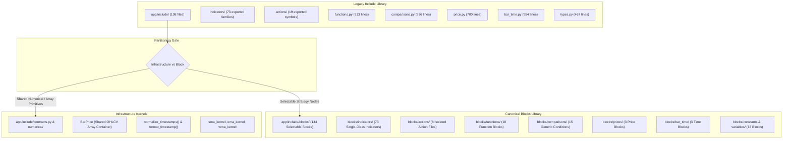

# Phase 0: Strategy Blocks Inventory & Baseline Report

Status: **Phase 0 Complete**
Baseline Commit: `78dae6ee`
Target Refactor Plan: [strategy-blocks-refactor-plan.md](file:///C:/Users/rharu/AppDev/HaruQuantAI/docs/dev/strategy-blocks-refactor-plan.md)

---

## 1. Executive Summary & Inventory Scope

An automated AST scan was performed across the entire [`app/include/`](file:///C:/Users/rharu/AppDev/HaruQuantAI/app/include/) package and its import consumers across the repository.

### Quantitative Summary

| Category | Exported Symbols | Selectable Blocks | Infrastructure / Helper Symbols | Legacy File Count |
| :--- | :---: | :---: | :---: | :---: |
| **Indicators** | 73 | 73 | 2 (`BaseIndicator`, `IndicatorSeries`) | 79 |
| **Functions** | 26 | 18 | 8 (pip conversion, math helpers, constants) | 1 (`functions.py`) |
| **Actions** | 19 | 8 | 11 (legacy function aliases, records, constants) | 6 |
| **Comparisons** | 29 | 15 | 14 (`MAType`, `round_value`, `resolve_shift_value`, etc.) | 1 (`comparisons.py`) |
| **Price** | 4 | 3 | 1 (`BarPrice` container) | 1 (`price.py`) |
| **Bar Time** | 5 | 3 | 2 (`normalize_timestamps`, `format_timestamp`) | 1 (`bar_time.py`) |
| **Types / Vars** | 12 | 13 | 1 (`Types` facade) | 1 (`types.py`) |
| **External Consumers** | - | - | 81 consumer files in `app/` and `tests/` | - |
| **Total** | **168** | **144** | **39** | **108** |

---

## 2. Infrastructure vs. Catalog Partitioning

To avoid treating runtime arrays and mathematical utilities as artificial block nodes, ownership is separated cleanly:

### Infrastructure (Retained in `app/include/` or `app/include/numerical/`)
- [`BarPrice`](file:///C:/Users/rharu/AppDev/HaruQuantAI/app/include/price.py#L27-L70): Remains the canonical OHLCV memory container. Price blocks consume it without re-wrapping.
- [`normalize_timestamps`](file:///C:/Users/rharu/AppDev/HaruQuantAI/app/include/bar_time.py#L34-L52) & [`format_timestamp`](file:///C:/Users/rharu/AppDev/HaruQuantAI/app/include/bar_time.py#L18): Retained as shared time utilities in [`contracts.py`](file:///C:/Users/rharu/AppDev/HaruQuantAI/app/include/contracts.py) or `time_utils.py`.
- [`resolve_shift_value`](file:///C:/Users/rharu/AppDev/HaruQuantAI/app/include/comparisons.py#L69-L70) & [`round_value`](file:///C:/Users/rharu/AppDev/HaruQuantAI/app/include/comparisons.py#L64-L68): Extracted to [`app/include/blocks/series.py`](file:///C:/Users/rharu/AppDev/HaruQuantAI/app/include/blocks/series.py).
- Numerical kernels (`calculate_ma`, `calculate_wma`, pip conversions): Relocated to `app/include/numerical/` as pure C/NumPy functions.

### Selectable Strategy Blocks (Destined for `app/include/blocks/`)
- **Single-class indicators**: 73 indicators under [`app/include/blocks/indicators/<category>/`](file:///C:/Users/rharu/AppDev/HaruQuantAI/app/include/blocks/indicators/).
- **Generic conditions**: `is_greater`, `is_lower`, `crosses_above`, `crosses_below`, `is_rising`, `is_falling`, `changes_up`, `changes_down`, `condition_and`, `condition_or`, `condition_not`.
- **Independently editable actions**: 8 separated files (`log_to_file.py`, `log_to_journal.py`, `send_email.py`, `draw_up_arrow.py`, `draw_down_arrow.py`, `draw_vertical_line.py`, `assign_variable.py`, `custom_action.py`).
- **Selectable variables and constants**: `BooleanConstant`, `NumberConstant`, `Variable`.

---

## 3. Stable ID & Path Mapping Convention

Each selectable strategy block receives a permanent, language-agnostic identifier formatted as `<kind>.<category>.<identifier>`:

| Block Type | Stable ID Format | Canonical Source Path | Legacy Shim Path |
| :--- | :--- | :--- | :--- |
| **Indicator** | `indicator.<category>.<name>` | `app/include/blocks/indicators/<category>/<name>.py` | `app.include.indicators.<category>.<name>` |
| **Function** | `function.<name>` | `app/include/blocks/functions/<name>.py` | `app.include.functions.<name>` |
| **Condition** | `condition.<name>` | `app/include/blocks/comparisons/<name>.py` | `app.include.comparisons.<name>` |
| **Action** | `action.<name>` | `app/include/blocks/actions/<name>.py` | `app.include.actions.<name>` |
| **Price** | `price.<name>` | `app/include/blocks/prices/<name>.py` | `app.include.price.<name>` |
| **Time** | `bar_time.<name>` | `app/include/blocks/bar_time/<name>.py` | `app.include.bar_time.<name>` |
| **Variable** | `variable.<type>` | `app/include/blocks/variables/<name>.py` | `app.include.types.<name>` |
| **Constant** | `constant.<type>` | `app/include/blocks/constants/<name>.py` | `app.include.types.<name>` |

---

## 4. Exceptional-Input & Parameter Behavior Findings

Testing edge cases across the baseline suite ([`SMA`](file:///C:/Users/rharu/AppDev/HaruQuantAI/app/include/indicators/trend/moving_average.py#L74), [`EMA`](file:///C:/Users/rharu/AppDev/HaruQuantAI/app/include/indicators/trend/moving_average.py#L86), [`RSI`](file:///C:/Users/rharu/AppDev/HaruQuantAI/app/include/indicators/momentum/rsi.py), [`BollingerBands`](file:///C:/Users/rharu/AppDev/HaruQuantAI/app/include/indicators/volatility/bollinger_bands.py), [`MACD`](file:///C:/Users/rharu/AppDev/HaruQuantAI/app/include/indicators/momentum/macd.py)) revealed critical legacy behaviors:

1. **Silent Fallback on Invalid Periods**:
   - In legacy code, passing `period <= 0` logs a warning and silently substitutes a hardcoded default (e.g. `period=14` for `RSI`, `period=20` for `BollingerBands`).
   - *Phase 1 Mandate*: In `BaseIndicator`, Pydantic fields (`period: int = Field(default=14, ge=1)`) will fail fast during instantiation rather than calculating incorrect indicator values.
2. **Warmup & Insufficient History**:
   - When inputs are shorter than `period`, legacy indicators return a full array of `NaN`s of matching length.
   - *Phase 1 Mandate*: `required_history()` specifies the minimum bars required. Calculations always return output aligned 1-to-1 with input rows, with `NaN` for warmup bars.
3. **Array Boundaries**:
   - Zero-length inputs return an empty array `[]` without error.
   - Non-finite values (`inf`) trigger `RuntimeWarning` in division/subtraction.

---

## 5. Baseline Benchmarks & Agreed Regression Budgets

Benchmarked on fixed synthetic data seeds (`np.random.default_rng(42)`) across 150 bars (CodeEditor window), 100k bars, and 1M bars.

### 5.1 Latency & Memory Performance

| Indicator | Algorithm Type | Window (Bars) | Cold Latency | Median Latency | p95 Latency | Peak Memory | Max Regression Budget (Median) |
| :--- | :--- | :---: | :---: | :---: | :---: | :---: | :---: |
| **SMA (period=20)** | Cumulative Sum Slice | 150 | 0.24 ms | **0.056 ms** | 0.081 ms | 7.0 KB | <= 0.07 ms |
| | | 100,000 | 2.01 ms | **1.72 ms** | 1.92 ms | 3.12 MB | <= 1.90 ms |
| | | 1,000,000 | 19.83 ms | **18.87 ms** | 19.61 ms | 31.25 MB | <= 20.00 ms |
| **EMA (period=20)** | Recursive Alpha | 150 | 0.20 ms | **0.081 ms** | 0.090 ms | 5.29 KB | <= 0.10 ms |
| | | 100,000 | 39.55 ms | **37.88 ms** | 44.76 ms | 1.57 MB | <= 40.00 ms |
| | | 1,000,000 | 388.39 ms | **386.90 ms** | 391.03 ms | 15.63 MB | <= 400.00 ms |
| **RSI (period=14)** | Recursive Wilder | 150 | 0.32 ms | **0.167 ms** | 0.417 ms | 9.42 KB | <= 0.20 ms |
| | | 100,000 | 92.36 ms | **86.92 ms** | 94.53 ms | 3.91 MB | <= 95.00 ms |
| | | 1,000,000 | 874.74 ms | **900.18 ms** | 925.17 ms | 39.07 MB | <= 950.00 ms |
| **BollingerBands (20, 2.0)** | Rolling StdDev | 150 | 2.48 ms | **1.903 ms** | 2.510 ms | 17.61 KB | <= 2.00 ms |
| | | 100,000 | 1,354 ms | **1,389 ms** | 1,598 ms | 7.82 MB | <= 1,400 ms |
| | | 1,000,000 | 13,482 ms | **13,730 ms** | 14,248 ms | 78.13 MB | <= 14,000 ms |
| **MACD (12, 26, 9)** | Multi-EMA Difference | 150 | 0.33 ms | **0.189 ms** | 0.203 ms | 16.20 KB | <= 0.22 ms |
| | | 100,000 | 81.32 ms | **84.04 ms** | 108.52 ms | 8.01 MB | <= 90.00 ms |
| | | 1,000,000 | 799.35 ms | **806.76 ms** | 819.47 ms | 80.08 MB | <= 850.00 ms |

> [!NOTE]
> The current legacy `BollingerBands` implementation exhibits $O(N \cdot K)$ rolling slice overhead, taking ~13.7s for 1M bars. In Phase 3, migrating to vectorized rolling stddev will provide substantial speedups while preserving identical numerical outputs.

### 5.2 Reference Output Fixtures (Numerical Bit-Parity Checkpoints)

| Indicator | Output Port | Window (Bars) | Warmup NaNs | First Valid Index | First Valid Value | Output SHA256 Prefix |
| :--- | :--- | :---: | :---: | :---: | :--- | :--- |
| **SMA (20)** | `value` | 150 | 19 | 19 | `98.92693668386704` | `c92738bf6b3b3222` |
| **EMA (20)** | `value` | 150 | 19 | 19 | `98.92693668386703` | `6512d20dab667636` |
| **RSI (14)** | `value` | 150 | 14 | 14 | `49.03666986138148` | `85dde62ed54c7656` |
| **BollingerBands (20, 2.0)** | `upper` | 150 | 19 | 19 | `101.0857473934458` | `9594d63eb5fa53b1` |
| | `middle` | 150 | 19 | 19 | `98.92693668386704` | `c92738bf6b3b3222` |
| | `lower` | 150 | 19 | 19 | `96.76812597428828` | `cd08fdf910bccf66` |
| **MACD (12, 26, 9)** | `main` | 150 | 25 | 25 | `0.27061016241707136` | `799b6afc871a2a35` |
| | `signal` | 150 | 33 | 33 | `0.5245544030605471` | `fab4dcb087f6b770` |
| | `histogram` | 150 | 33 | 33 | `0.29229818785712935` | `0fba818175789232` |

---

## 6. Persistence & Extension Archive Analysis

1. **Archive Packages**:
   - `ImportExport.export()` creates `.zip`/`.sxp` packages with a `manifest.json` containing `files: ["app/include/..."]`.
   - *Migration Requirement*: The import loader must support remapping old `app/include/indicators/` paths in archives to canonical `app/include/blocks/indicators/` destinations.
2. **UI Strategy Documents**:
   - AlgoWizard [`algoWizardModel.ts`](file:///C:/Users/rharu/AppDev/HaruQuantAI/ui/app/workspace/AlgoWizard/algoWizardModel.ts#L10-L13) currently stores blocks as plain `{id: string, text: string}`.
   - Builder [`settingsFixtures.ts`](file:///C:/Users/rharu/AppDev/HaruQuantAI/ui/app/workspace/Builder/settings/settingsFixtures.ts#L194-L200) currently uses hardcoded string catalogs.
   - *Migration Requirement*: The schema-versioned strategy document introduced in Phase 6 will replace both with typed block references (`stable_id`, `version`, `parameters`).

---

## 6. Exit Gate Checklist for Phase 0

- [x] Complete inventory of all 73 indicators, functions, actions, comparisons, and price/time blocks.
- [x] Full migration manifest generated with stable IDs, canonical paths, and parameter signatures ([`full_migration_manifest.json`](file:///C:/Users/rharu/.gemini/antigravity-cli/brain/7ec5df9b-2d6e-4fa6-b498-42ac49fca762/scratch/full_migration_manifest.json)).
- [x] Boundary and exceptional-input behavior recorded across baseline indicators ([`exceptional_inputs.json`](file:///C:/Users/rharu/.gemini/antigravity-cli/brain/7ec5df9b-2d6e-4fa6-b498-42ac49fca762/scratch/exceptional_inputs.json)).
- [x] Repository consumers mapped (81 importing files cataloged).
- [x] CodeEditor and workspace test suites passing (562 tests, 19 indicator unit tests).
- [x] Benchmark baseline suite established for synthetic 150, 100k, and 1M bar datasets.
